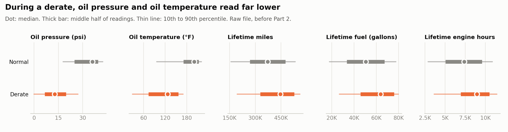
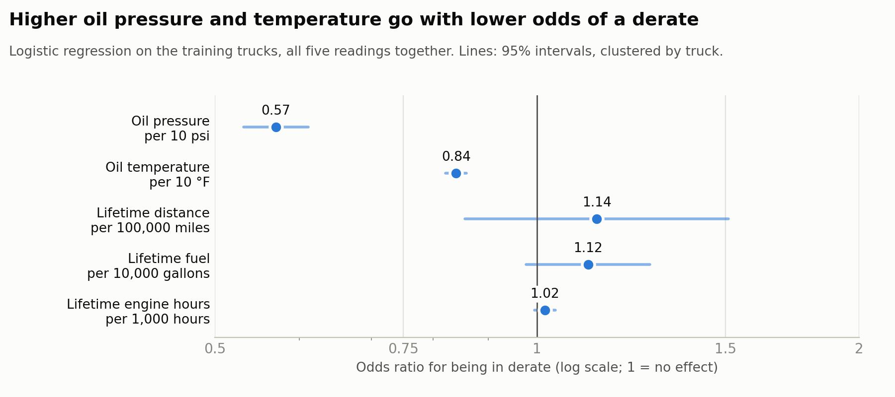
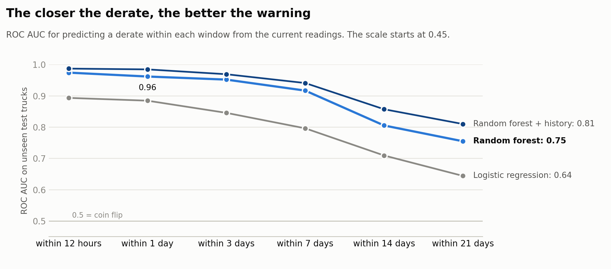

# Predicting Truck Derates from Engine Readings

**Juan Zavala** · AI for Analytics · Big NSS Express · built with Claude as a pair programmer

`big_nss.csv` holds 1,187,335 rows of timestamped readings from 1,122 heavy trucks. A **full derate** is when a truck's computer cuts engine power to protect itself, and the truck needs a tow. The assignment asks four things: compare the readings during a derate vs normal operation, fill the nulls in five prescribed steps, predict whether a truck is in derate *now*, and predict whether it will derate *soon*.

| On trucks the models never saw | Logistic regression | Random forest |
|---|---|---|
| **Is it in derate now?** ROC AUC | 0.913 | **0.960** |
| **Will it derate within a day?** ROC AUC | 0.885 | **0.962** |
| In derate now: accuracy at the usual 0.5 threshold | 99.89% | 99.89% |
| In derate now: accuracy of always saying "no derate" | 99.89% | 99.89% |

**Bottom line:**

- **Accuracy is useless here.** About 1 reading in 1,000 is a derate, so both models match the do-nothing baseline exactly, and at the 0.5 threshold neither flags a single reading. The real measures (ROC AUC, PR AUC, and precision and recall at an alert level) show the random forest ranks derate risk well.
- **A day ahead, the forest's warning is useful.** If we flag the riskiest 1% of readings, 160 of the 246 derate episodes in the test trucks (65%) get at least one warning in the 24 hours before, with a median of 12.6 hours' notice. About 1 in 4 flags is real.
- **The warning fades with distance.** ROC AUC falls from 0.974 (12 hours) to 0.755 (21 days).
- **The model relies on the oil readings, not the lifetime counters.** Readings in the day before a derate look like an engine that is off, idling or not yet warm: median oil temperature 130 °F vs 201 °F, and 20% show an oil pressure of exactly 0 (vs 7% otherwise).

**Start here:**

* [`derate_prediction.ipynb`](derate_prediction.ipynb): the full analysis, Parts 1 to 4, with every check. GitHub shows it with all outputs.
* [`derate_lab.html`](derate_lab.html): an interactive dashboard. Download it and open it in a browser to pick a warning window and model, move an alert-level slider, and play the "draw a random pair" game that shows what ROC AUC means.
* [`results/`](results): every table behind the numbers on this page.

---

## Four findings

### 1. During a derate, the oil readings drop



Median oil pressure is 12.8 psi during a derate vs 36.0 psi otherwise. Median oil temperature is 127 °F vs 201 °F.

Derate rows also come from trucks with more miles (446,060 vs 372,713 median lifetime miles). But that is largely a *truck* effect, not a *moment* effect:

* The 215 trucks that ever derate have typical oil readings close to the rest of the fleet (35.4 vs 34.2 psi).
* Their median lifetime distance is 379,838 miles vs 264,197.

### 2. Accuracy hides everything; the ranking measures don't

Both models score 99.89% accuracy, the same as always answering "no derate". On unseen trucks:

* **Ranking:** the random forest reaches ROC AUC 0.960 (95% range over resampled test trucks: 0.926 to 0.981) and PR AUC 0.192 (guessing scores 0.0011).
* **Alert level:** flagging the riskiest 1% of readings catches 77% of the derate readings.
* **Leakage check:** a random row split, which puts 1,033 of the 1,092 trucks on both sides, gives the forest 0.984 instead of 0.960.

### 3. Higher oil pressure and temperature go with lower odds of a derate



* **Oil pressure: 0.57 per 10 psi** (95% interval 0.53 to 0.61). Each extra 10 psi goes with 43% lower odds of being in derate, holding the other readings fixed.
* **Oil temperature: 0.84 per 10 °F** (0.82 to 0.86). Each extra 10 °F goes with 16% lower odds.
* **Lifetime counters:** all three intervals include 1, so they show no clear effect once the oil readings are in the model.
* **The intervals are clustered by truck,** because readings from one truck aren't independent. The oil readings' intervals are the ones to rely on; with only 148 derating trucks in training, the counters' intervals are rough.

### 4. The further ahead the derate, the weaker the ranking



The 1-day forest's ROC AUC is 0.962 (95% range 0.940 to 0.978). Because 0.96 a day ahead looked too good, it was checked three ways:

* **Not just last-minute warnings.** With positives closer than 12 hours to the derate left out, ROC AUC is still 0.944.
* **Moments, not just trucks.** Scoring only the trucks that derate within a day at least once, the ROC AUC is 0.961, nearly the 0.962 overall. Within a single truck, the model ranks that truck's pre-derate readings above its other readings with a median ROC AUC of 0.985 (51 test trucks; 10th percentile 0.875).
* **What it reacts to.** Shuffling oil pressure or oil temperature costs 0.254 and 0.163 of ROC AUC. Shuffling any lifetime counter costs 0.017 or less.

**Extension, beyond the assignment:** adding the truck's recent derate history (days since the last derate, derates in the past week) raised ROC AUC at every window, to 0.985 at 1 day and 0.810 at 21 days. Derates cluster: a truck's next episode comes a median of 0.88 days after the previous one.

---

## Every assignment question, answered

| Part | Question | Answer | Where |
|---|---|---|---|
| 1 | Read `big_nss.csv` as `big_nss` | Done, with `EquipmentID` read as text. A default read splits 867 trucks into two IDs each (1,989 IDs for 1,122 trucks) | Part 1 |
| 1 | Visualize the 5 measurements, derate vs not | Five-panel chart: oil pressure and temperature read far lower during a derate; lifetime counters run higher | Part 1, finding 1 |
| 2a | Drop rows with all 5 measurements null | 527,038 rows dropped, including 623 derate rows, whose times were saved first for Part 4 | Part 2 |
| 2b | Drop trucks with only NaNs in ≥ 2 Ltd columns | 4 trucks (4 rows) | Part 2 |
| 2c | Predict missing Ltd values from an existing Ltd value | 9,815 values: 6,536 from the same truck's own readings (the neighbor method; median error in a test of hidden values 0.0004% to 0.0015%), and 3,279 engine-hours values for 14 trucks that never report hours, from the fleet's median ratio (median test error 3.1%) | Part 2 |
| 2d | Fill the remaining Ltd nulls in equal increments within each truck | 414 rows (1,242 values) filled; 115 rows at a truck's start or end dropped, since they have no value on one side | Part 2 |
| 2e | Predict EngineOil values from Ltd (and the other oil value) | 4,114 values, from four boosted-tree models chosen over the mean and linear regression by a hidden-value test | Part 2 |
| 3 | What a train/test split is, and do one | Train on some trucks, grade on others. The split is by truck, so the test uses 272 trucks the models never saw | Part 3 |
| 3 | Logistic regression and random forest | ROC AUC 0.913 and 0.960, with 95% ranges | Part 3, finding 2 |
| 3 | Odds ratios and what they mean | 0.57 per 10 psi of oil pressure, 0.84 per 10 °F of oil temperature, with truck-clustered intervals and VIFs | Part 3, finding 3 |
| 3 | How accurate are the predictions? | 99.89% accuracy is meaningless (it equals the baseline). The forest ranks well (ROC AUC 0.960) and catches 77% of derate readings at a 1% alert level | Part 3 |
| 4 | A type of prediction for future derates | Early-warning classification with a look-ahead window; survival analysis is the alternative | Part 4 |
| 4 | ROC AUC at 12 hours and 1, 3, 7, 14, 21 days | Forest 0.974, 0.962, 0.952, 0.917, 0.805, 0.755. Logistic 0.894, 0.885, 0.846, 0.796, 0.710, 0.644 | Part 4, finding 4 |
| 4 | Efficient target creation | `pd.merge_asof` (no loops or `iterrows`), cross-checked by a second method that agrees on all 529,953 readings | Part 4 |
| 4 | What ROC AUC tells you, and doesn't | It measures ranking. It says nothing about how many alerts are real, whether a derate gets a warning in time, or calibration. Separate checks cover the first two; calibration wasn't checked | Part 4 |
| 4 | The 1-day model's ROC AUC, explained | 0.962: a reading from the day before a derate outranks a reading with no derate in the next 24 hours about 96 times in 100 | Part 4 |

---

## Data problems found before filling (Step 0)

The assignment's steps assume clean inputs. The profile in Part 1 found four problems that would have corrupted them:

| Problem | Evidence | Fix |
|---|---|---|
| Truck IDs split by the CSV reader | 3 IDs contain letters, so pandas parses some chunks as text and the rest as numbers: 867 trucks appear twice | Read `EquipmentID` as text |
| 129,331 exact duplicate rows | Same truck, timestamp, readings and derate flag; only RecordID differs | Removed |
| Impossible values | 176 oil temperatures of 3,000 °F or more (after removing duplicates). The values 3,212.49 and 3,212.54 °F decode to J1939 error codes 0xFEFE and 0xFEFF; the rest are above J1939's valid maximum of 3,154.9 °F. Also 2,722 lifetime counters read exactly 0. None are derate rows | Set to null, then filled by the assignment's steps |
| Clock errors | 339 rows dated 2000 to 2011 or 2026; 170 of the 184 with a mileage reading fall inside the same truck's 2015–2020 mileage range | Dropped |

A fifth issue matters for Part 4: **step 2a deletes 623 derate rows** because they have no readings. They are still real derates, so every derate time was saved before step 2a, and the Part 4 labels come from those saved times.

## How Claude was used

Claude (Anthropic's AI, working in Cowork) explored the data, proposed methods, wrote and ran the code, and built every check. I set the direction, reviewed each plan before code was written, and signed off on the judgment calls. Each part of the notebook follows the order the assignment asks for: a plain-English discussion, the plan, then code, then a check. The prompts are recorded in the notebook.

**Where an idea didn't hold up, and what caught it:**

| Idea | What the evidence showed |
|---|---|
| Read the CSV with pandas' defaults | The truck count was wrong: 1,989 IDs for 1,122 trucks |
| Fill 2c with one straight line per truck | A test of hidden values showed its worst 1% of estimates were off by 26% to 77%. The neighbor method's worst 1% were off by 0.26% or less |
| The ROC AUC of 0.96 a day ahead must be a fluke of last-minute warnings or of telling trucks apart | It held up: 0.944 without the closest 12 hours, and a median of 0.985 within single trucks |
| Accuracy tells us how good the model is | Both models equal the always-"no derate" baseline (99.89%) and catch 0 derates at the 0.5 threshold |

**Judgment calls:**

* The split is by truck (`StratifiedGroupKFold`, one of 4 folds held out) rather than by row, so the test is honest about new trucks.
* Readings already in a derate, and the 96 readings that share a timestamp with a derate, are left out of Part 4.
* A derate **episode** is a run of consecutive derate rows for one truck. A derate that flickers on and off counts as more than one episode.
* A reading with no derate in the window counts as a "no" only if the truck was observed for the whole window afterward (censoring). This removed 1,385 to 9,694 readings per window.
* `Derate` is never an input when filling oil readings, since it is the target in Parts 3 and 4.
* The random forest uses capped settings (100 trees, 30% of rows per tree, at least 20 rows per leaf) to keep it fast and stop it from memorizing single readings.

## How the numbers were checked

* **Every fill** is asserted to leave known values unchanged (steps 2c, 2d and 2e). Lifetime-counter fills are asserted positive, oil fills are asserted to lie within the range of real readings, and the clean table is asserted to have no nulls.
* **Fill methods** were chosen by hiding known values and predicting them back (`results/ltd_fill_validation.csv`, `results/oil_fill_validation.csv`).
* **Labels** were built twice, with `merge_asof` and with a back-filled timeline, and asserted equal for all 529,953 normal readings.
* **Uncertainty:** 95% ranges for ROC AUC come from resampling whole test trucks 1,000 times.
* **Charts:** each chart's title is a claim, and the code asserts it before drawing.
* **The dashboard's scoring engine** was checked against the same calculations in Python: 3,493 checks, 0 mismatches.
* **Reproducibility:** the notebook was also run under Python 3.9.23 with numpy 2.0.2 and scikit-learn 1.6.1 (the versions installed on the Mac this was submitted from) and pandas 2.3.3. The main run used Python 3.11 with pandas 3.0.2. Three results files, including the dashboard's data, came out byte-for-byte identical. The other four differ only by floating-point noise, at most 2.4 × 10⁻¹⁰ relative. Every code cell is valid Python 3.9.

## Limitations

* **One fleet, one period.** The data covers 2015 to March 2020 for one company's trucks, so the patterns may not carry over to another fleet.
* **Associations, not causes.** The models learn that cold, low-pressure readings come before derates. This data can't say why. One possibility is engines being restarted or idling around a developing fault.
* **Scores aren't probabilities.** The models were trained on the natural positive rates (about 0.1% to 2.7% of training readings) and not calibrated. Use them to rank trucks, not to quote a chance of derating.
* **Filling looks both ways in time, and across trucks.** Step 2d's interpolation and the neighbor method use readings from after the moment being filled. The oil-fill models and the fleet ratios were fit on all trucks, test trucks included, before the split (no target was used). That is the order the assignment specifies, but a live system would only have past readings.
* **Cold oil readings were kept.** 339 raw readings are below 0 °F (as low as −118 °F). The assignment notes that readings during a derate can be unreliable, so these were left as readings, not set to null.
* **Readings during a derate are unreliable,** as the assignment notes, so Part 3's model partly detects the sensor behavior of a derate in progress.

## Files

| File | What it is |
|---|---|
| `README.md` | This page |
| `derate_prediction.ipynb` | Parts 1 to 4, executed with all outputs |
| `derate_lab.html` | Interactive dashboard (one file; it loads web fonts when online and falls back to system fonts offline) |
| `requirements.txt` | Python packages |
| `data/README.md` | Where to get `big_nss.csv` (85 MB, not committed) and how to confirm it's the same file |
| `results/null_filling_steps.csv` | Rows, trucks and derate rows after every cleaning and filling step |
| `results/ltd_fill_validation.csv`, `results/oil_fill_validation.csv` | The hidden-value tests behind the fill methods |
| `results/current_derate_metrics.csv`, `results/odds_ratios.csv` | Part 3 scores and odds ratios |
| `results/horizon_auc.csv` | Part 4 ROC AUC and PR AUC by window and model |
| `results/lab_data.json` | Curves and summaries the dashboard is built from |
| `images/` | The three charts above |

## Reproduce it

```bash
cd submissions/juan_zavala
pip3 install -r requirements.txt
# put big_nss.csv in data/ (see data/README.md)
jupyter nbconvert --to notebook --execute --inplace --ExecutePreprocessor.timeout=1800 derate_prediction.ipynb
```

Or open the notebook in VS Code, pick a Python kernel and choose **Run All**. A full run took about 8 minutes on a 2-core cloud machine in testing (464 seconds under Python 3.9), with peak memory of about 1.6 GB. A laptop with more cores will be faster.
